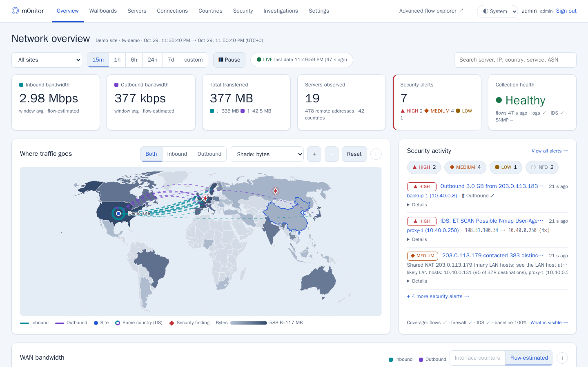
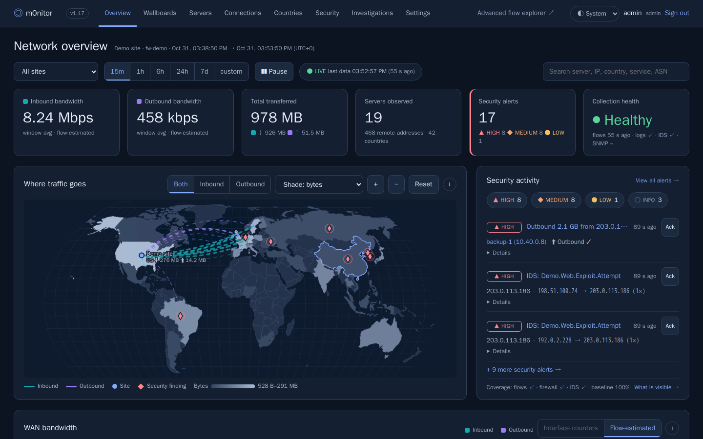
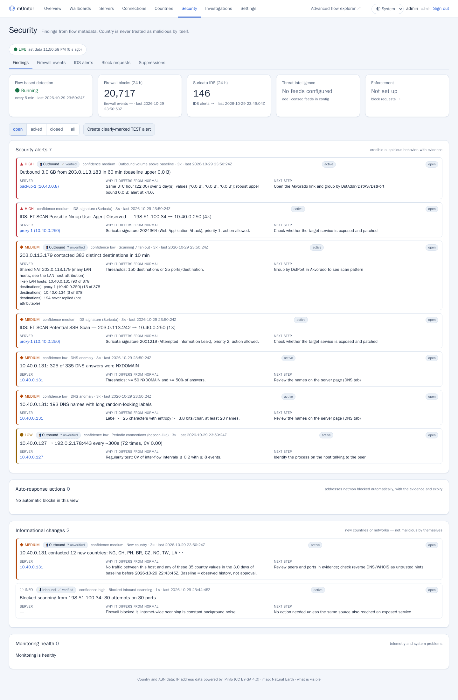
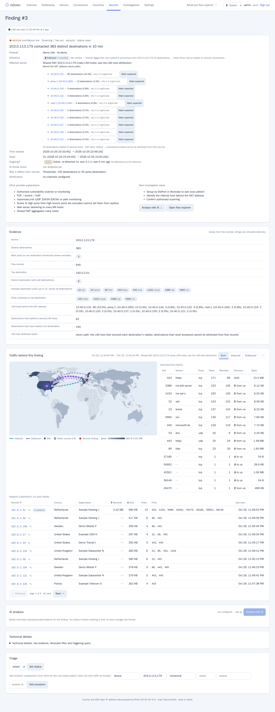
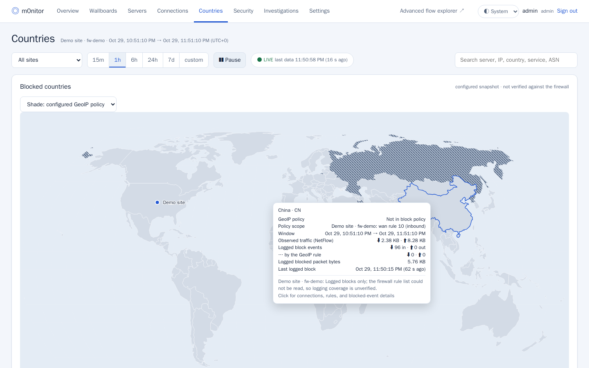
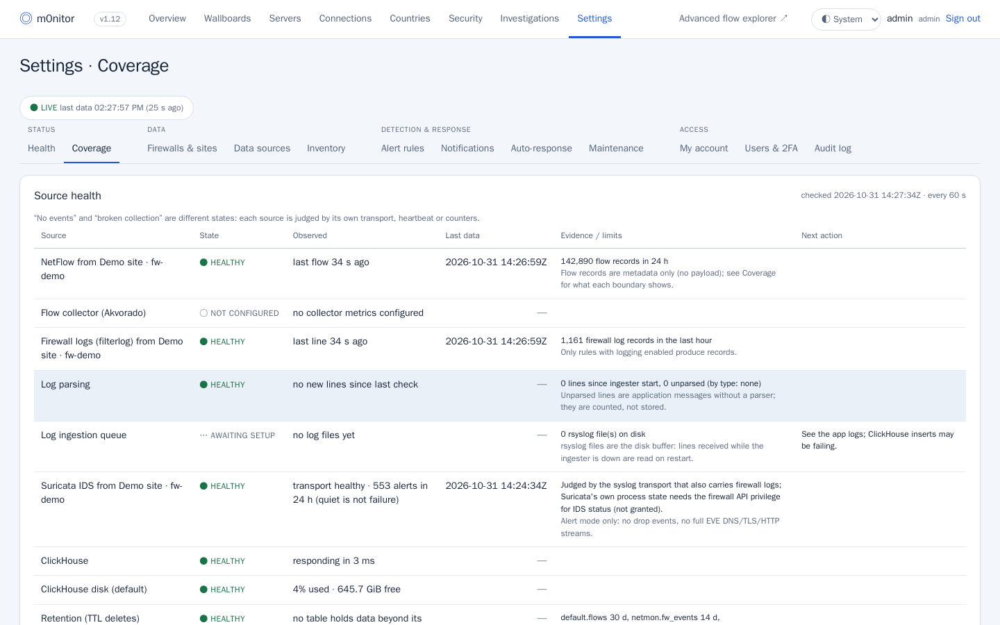
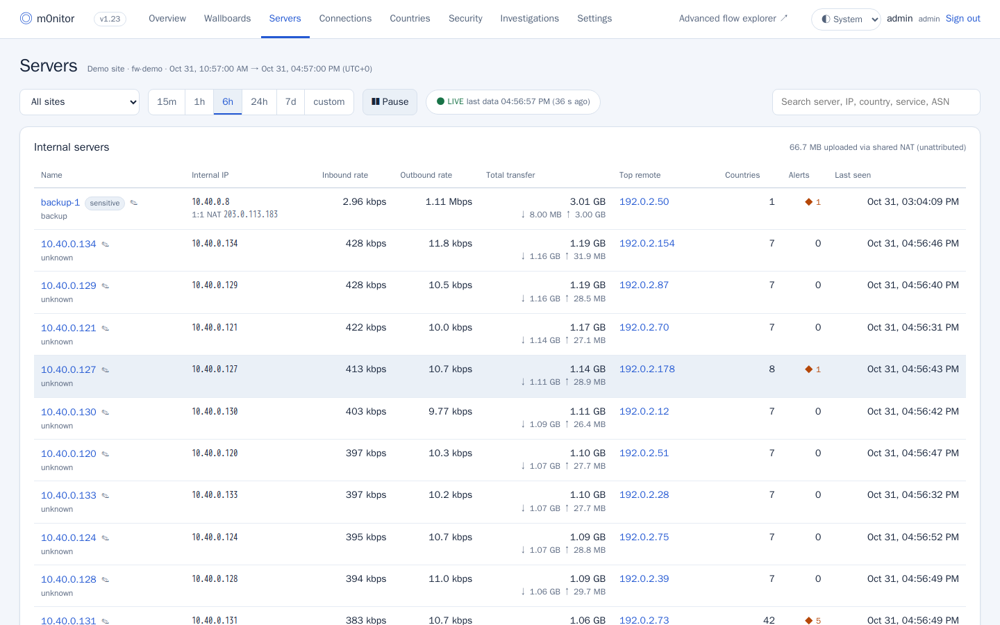
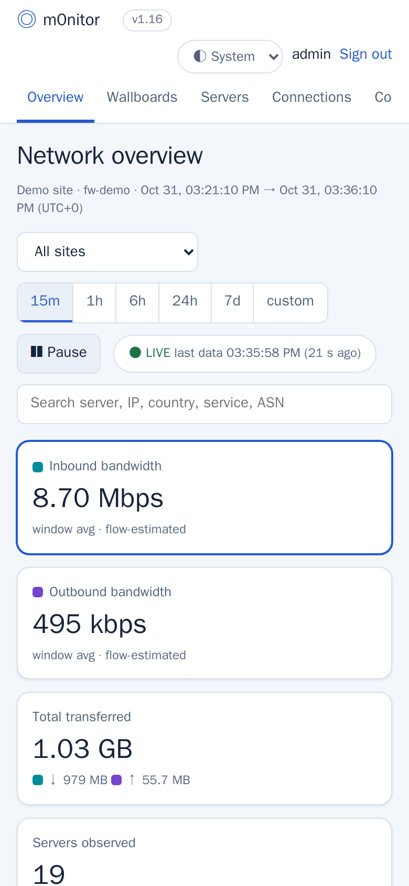

# m0nitor

Self-hosted network monitoring for OPNsense (and, with limits, pfSense) firewalls. The firewall only
*sends* telemetry (NetFlow v9, remote syslog, optional SNMP); the monitor never sits in the forwarding path, so if it
stops, traffic is unaffected.

> **Status:** pre-release. Licensed under the [MIT License](LICENSE); bundled third-party files keep their own licenses (see [NOTICE](NOTICE)), notably `akvorado/config/*`, which stays AGPL-3.0.
> The internal Python package is still called `netmon`.

## What it does

- **Traffic:** per-server bandwidth, connections with direction/protocol/port filters, countries and organizations,
  a world map of traffic directions, wallboards. Flow storage and the advanced explorer are [Akvorado](https://github.com/akvorado/akvorado).
- **Security findings:** explainable rules (new destination country/ASN, unexpected inbound, outbound volume, fan-out
  and port scans, beaconing, blocked-traffic patterns, IDS alerts, DNS anomalies, source health). Every finding carries
  its evidence, the exact query, the baseline it was compared to, alternative explanations and next steps.
- **NAT attribution:** traffic behind a shared outbound NAT address is attributed to LAN hosts from the return path,
  with an explicit confidence tier — see [docs/nat-attribution.md](docs/nat-attribution.md).
- **Firewall context:** logged block decisions by country, the live GeoIP policy (policy vs. enforcement), Suricata
  alerts, configuration-change and authentication events from syslog.
- **Coverage page:** which telemetry is actually arriving, judged per source, and what each capability can and cannot see.
- **Expected devices:** mark known-legitimate hosts (crawlers, scanners you run) so they stop raising findings —
  including their share of traffic behind a shared NAT address.
- **Optional, off by default:** approval-gated blocking through one firewall alias, a switchable auto-response
  (brute force / IDS / floods — never scans) with dry-run mode, manual preview-first AI analysis (pseudonymized
  evidence, per-day caps), notifications (Pushover, webhook) after a successful test.

What it does **not** do: decrypt TLS, see payloads, see LAN-to-LAN traffic that does not cross the firewall (unless an
optional Zeek sensor on a mirror port is added), or guarantee complete coverage — absence of evidence is shown as such.

## Screenshots (demo data)

| | |
|---|---|
|  |  |
|  |  |
|  |  |
|  |  |

All screenshots come from the isolated demo (docs/demo.md): synthetic data, documentation address ranges.

## Try it

    docker compose -f demo/docker-compose.yml up -d --build     # see docs/demo.md

## Docs

    docs/demo.md             isolated demo with synthetic data
    docs/architecture.md     components, data flow, trust boundaries
    docs/install.md          install, upgrade, uninstall, backup, restore, rollback
    docs/opnsense-setup.md   NetFlow, syslog, SNMP, Suricata, API user (read-only + one alias)
    docs/BLOCKING.md         one-time blocking setup per firewall
    docs/privacy-hardening.md  ports, users, secrets, data retention
    docs/troubleshooting.md
    docs/api.md              HTTP API and ClickHouse schema
    docs/ROADMAP.md

## Repository layout

    app/                 FastAPI application (package netmon), static UI, tests (synthetic fixtures only)
    akvorado/            overlay for an upstream Akvorado release: config/ and docker-compose-local.yml
    caddy/               TLS front end (Caddyfile uses NETMON_SITE from .env)
    host/                root-side helpers: site/ACL renderer, encrypted backup, systemd units
    config.example.yaml  example app configuration (documentation and private addresses only)
    .env.example         deployment variables (no secrets)

## Development

    cd app
    docker build --build-arg DEV=1 -t netmon-app:test .
    docker run --rm netmon-app:test python -m pytest -q -p no:cacheprovider tests

Tests use `app/tests/fixtures/config.yaml` and never need a firewall, ClickHouse or OpenAI. See CONTRIBUTING.md.
