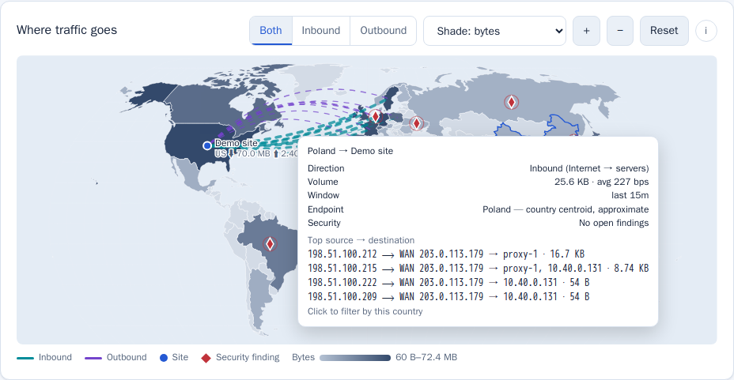
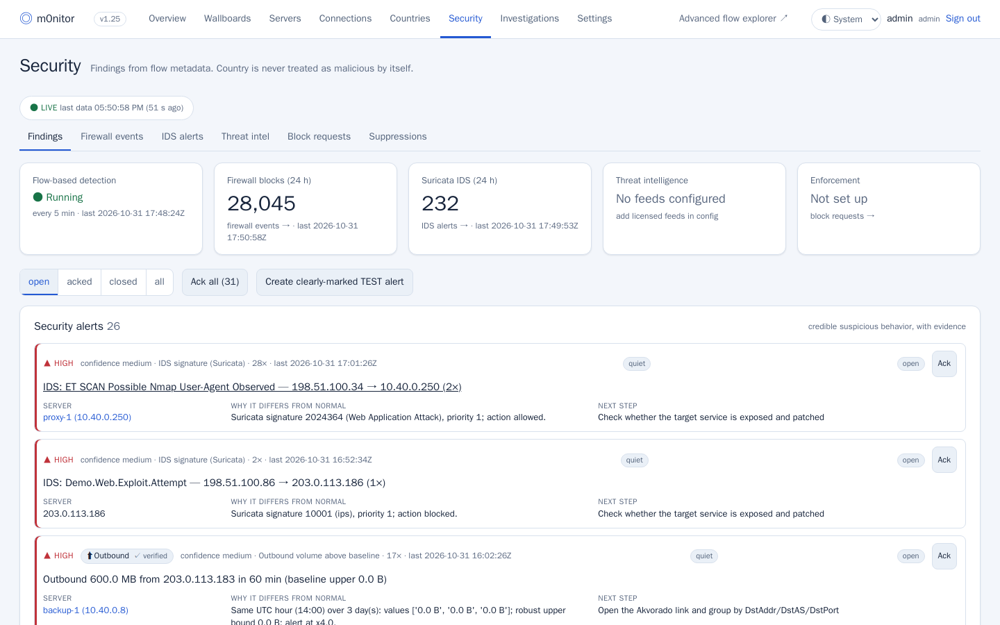
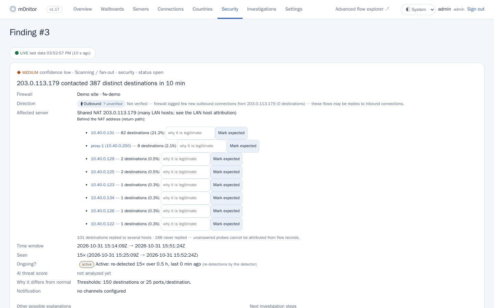
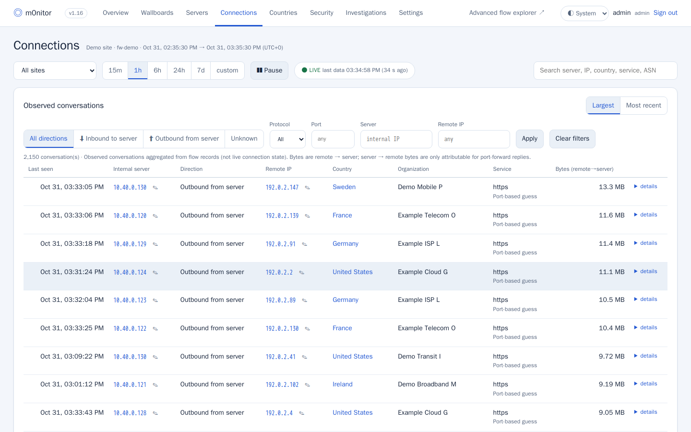
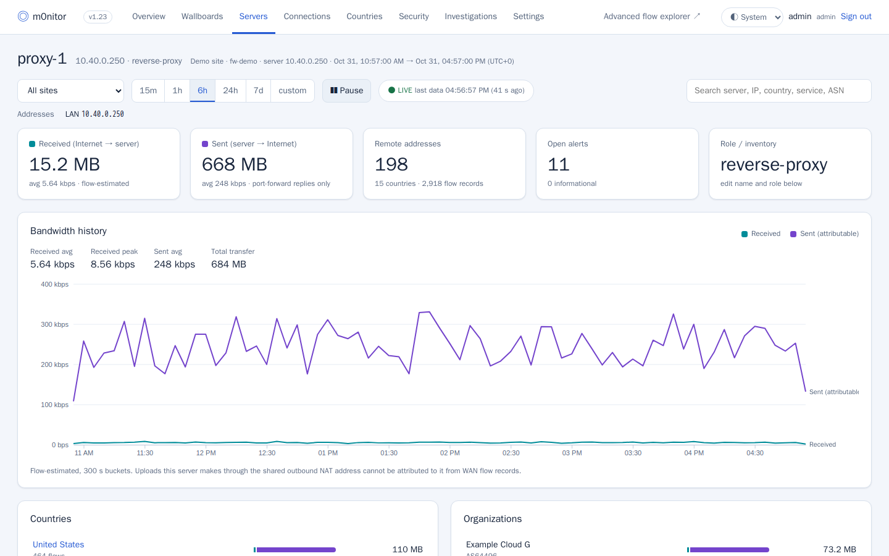
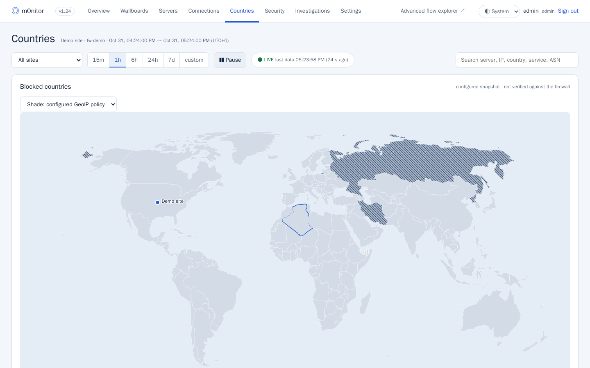
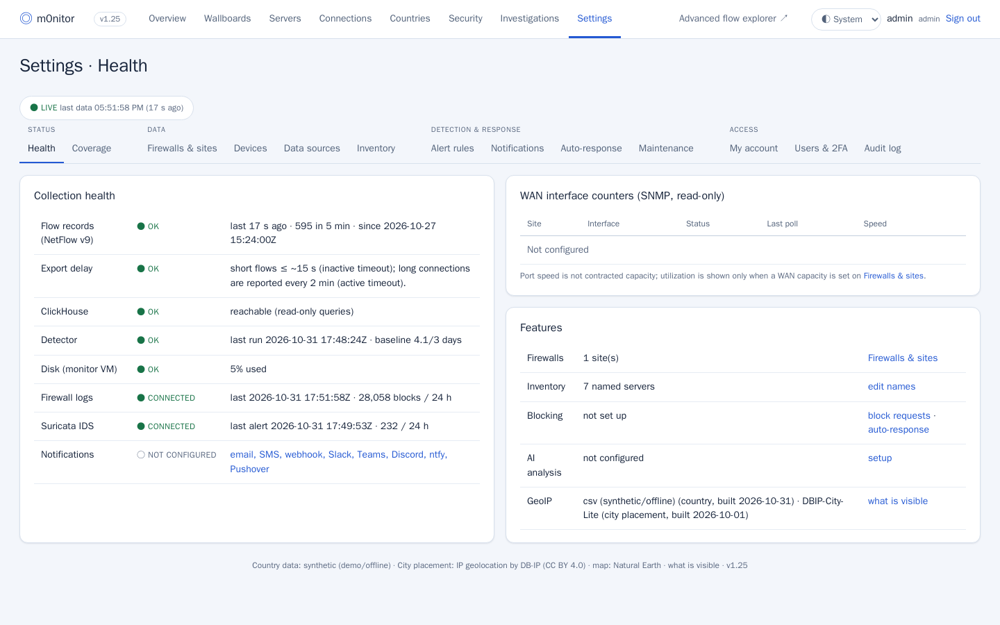
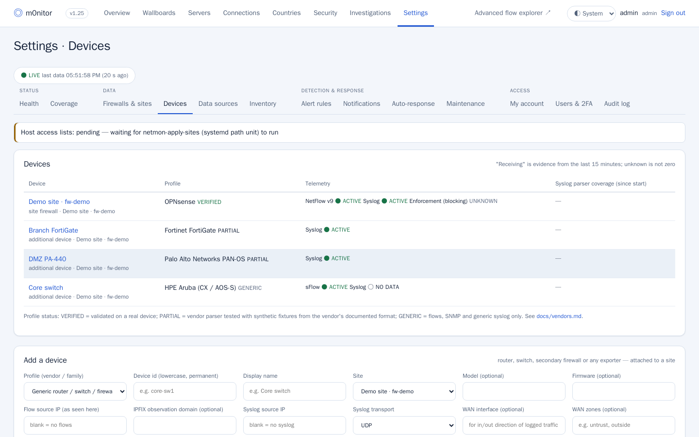
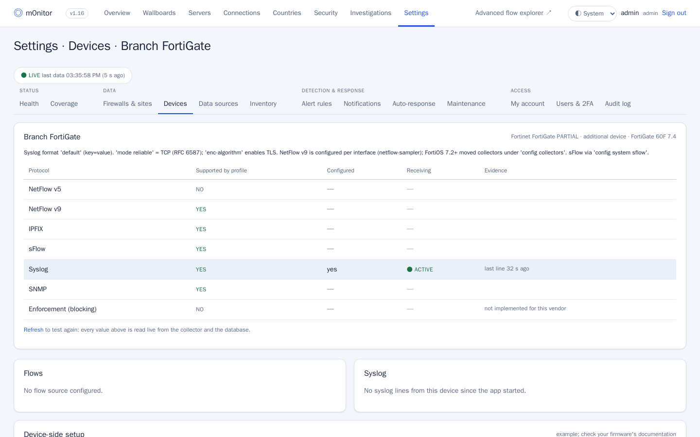
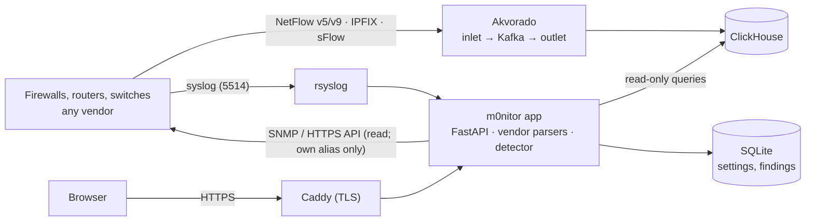

<h1 align="center">m0nitor</h1>

<p align="center">
  <b>Self-hosted traffic and security monitoring for firewalls, routers and switches — verified on OPNsense, with parsers for 20+ vendors.</b><br>
  See where your traffic goes, which servers talk to whom, and what deserves a closer look — with the evidence behind every finding.
</p>

<p align="center">
  <a href="https://github.com/agit8or1/m0nitor/actions/workflows/ci.yml"></a>
  <a href="https://github.com/agit8or1/m0nitor/tags"></a>
  <a href="LICENSE"></a>
  
</p>

<p align="center">
  
</p>

Devices only **send** telemetry — NetFlow v5/v9, IPFIX, sFlow, remote syslog and optional SNMP. m0nitor never sits in
the forwarding path: if it stops, your traffic is unaffected.

> **Pre-release.** m0nitor runs in production on the maintainer's network, but there is no installer yet and
> interfaces may change between versions. See the [roadmap](docs/ROADMAP.md) and [changelog](CHANGELOG.md).

## Features

- **Any device, honestly labelled** — device profiles for OPNsense, pfSense, FortiGate, PAN-OS, Cisco ASA/FTD/IOS,
  Meraki, Juniper, MikroTik, UniFi, EdgeOS, VyOS, Linux, OpenWrt, SonicWall, Sophos, WatchGuard, Check Point, Huawei
  and Generic. Each shows what the device documents, what is configured and what actually arrives; vendor parsers
  normalize firewall decisions, IDS, VPN, login, configuration, interface, routing and HA events.
  → [Devices](docs/devices.md) · [Compatibility](docs/vendors.md)
- **Traffic** — per-server bandwidth, connections with direction, protocol and port filters, countries and
  organizations, wallboards. Flow storage and the advanced flow explorer are [Akvorado](https://github.com/akvorado/akvorado).
- **World map** — inbound and outbound arcs, city-level placement, zoom up to 24×, and tooltips that list the
  busiest *source → destination* pairs with the firewall's WAN address or WAN alias, the internal servers behind it,
  and reverse DNS names. → [Maps](docs/maps.md)
- **Explainable security findings** — new countries or networks, unexpected inbound services, outbound volume,
  scanning and fan-out, beaconing, blocked-traffic patterns, Suricata IDS alerts, DNS anomalies and monitoring health.
  Every finding carries its evidence, the exact query, the baseline, alternative explanations and next steps.
  → [Findings and alerting](docs/alerting.md)
- **NAT attribution** — traffic behind a shared outbound NAT address is attributed to LAN hosts from the return path,
  with an explicit confidence tier. → [NAT attribution](docs/nat-attribution.md)
- **Firewall context** — logged blocks by country, the live GeoIP policy (policy vs. enforcement), configuration and
  authentication events from syslog.
- **Coverage** — which telemetry is actually arriving and what each view can and cannot see.
- **Threat intelligence** — IDS findings citing exploited CVEs (CISA KEV, EPSS) are marked; server software is matched
  against current CVEs. → [Threat intel](docs/threat-intel.md)
- **Optional, off by default** — approval-gated blocking through one firewall alias, auto-response with a dry-run
  mode, preview-first AI analysis with pseudonymized evidence, and notifications (email, SMS, webhook, Slack, Teams,
  Discord, ntfy, Pushover).

**What it does not do:** decrypt TLS, inspect payloads, see LAN-to-LAN traffic that does not cross the firewall
(unless you add the optional [Zeek sensor](docs/zeek-sensor.md)), or promise complete coverage — missing evidence is
shown as missing.

## Screenshots

All screenshots come from the isolated [demo](docs/demo.md): synthetic data and documentation address ranges only.

| | |
|---|---|
|  **Overview — dark mode** |  **Map tooltip — source → destination** |
|  **Security findings** |  **Finding detail — NAT attribution** |
|  **Connections** |  **Server bandwidth** |
|  **Countries and GeoIP policy** |  **Coverage and source health** |
|  **Servers** |  **Settings** |
|  **Devices — multi-vendor onboarding** |  **Device detail — evidence per protocol** |

<p align="center"><br><b>Mobile</b></p>

## Quick start

**Try the demo** — no firewall needed. It runs on an isolated Docker network with synthetic traffic:

```sh
git clone https://github.com/agit8or1/m0nitor.git && cd m0nitor
docker compose -f demo/docker-compose.yml -f demo/view.yml up -d --build
docker compose -f demo/docker-compose.yml logs seed | grep "admin password"
# open http://127.0.0.1:8099 and sign in as admin
```

**Install for real** — follow [docs/install.md](docs/install.md) (Akvorado, the app, the TLS front end and host
helpers), then [configure your firewall](docs/opnsense-setup.md) and check the Coverage page.

## Supported devices

| Status | Devices | What works |
|---|---|---|
| **VERIFIED** | OPNsense (26.x) | everything on this page: NetFlow (per-host after NAT), filterlog, Suricata EVE, Unbound, audit/VPN/gateway logs, live GeoIP policy and inventory via API, blocking |
| **PARTIAL** | pfSense, FortiGate, PAN-OS, Cisco ASA / FTD / IOS-XE, Meraki MX, Juniper SRX, MikroTik, UniFi, EdgeOS, VyOS, Linux nftables/iptables, OpenWrt, DD-WRT, SonicWall, Sophos, WatchGuard, Check Point, Huawei | flows, SNMP and a vendor log parser tested with synthetic fixtures from the vendor's documented format — **not yet validated on hardware**; blocking only on pfSense |
| **GENERIC** | HPE Aruba, TP-Link Omada, any other router or switch | NetFlow/IPFIX/sFlow, SNMP, syslog stored and keyword-categorized; no firewall decisions |

Per-protocol details, firmware notes and test coverage: [docs/vendors.md](docs/vendors.md). Reports from real devices
(with a sanitized log sample) move a profile to VERIFIED.

## Architecture



Requirements: a Linux VM (4 vCPU, 8 GB RAM, SSD) with Docker Engine and the compose plugin. Components: Akvorado and
ClickHouse (flows), the m0nitor app (Python 3.12, FastAPI), rsyslog and Caddy. Details and trust boundaries:
[docs/architecture.md](docs/architecture.md).

## Sizing

| Site | Flow records/s (avg) | vCPU | RAM | Disk (30-day flows) | Basis |
|---|---|---|---|---|---|
| Small office, 1 firewall | up to ~500 | 4 (min) – 8 | 8 – 16 GB | 128 GB SSD | measured on a reference installation (≈250/s) |
| Several firewalls / busy site | 500 – 5,000 | 8 | 16 GB | 250 – 500 GB SSD | storage calculated; CPU/RAM **not yet measured** |
| Large | > 5,000 | — | — | calculate | **unknown**: benchmark the target hardware |

No CPU throughput is claimed beyond what has been measured. Once installed, **Settings → System → Capacity planner**
sizes your own server from its measurements: what it handles today, what runs out first, and what a new
installation needs. See [hardware sizing](docs/hardware-sizing.md), [capacity planning](docs/capacity-planning.md),
[firewall resource requirements](docs/firewall-resource-requirements.md) and
[performance benchmarks](docs/performance-benchmarks.md).

## Documentation

| | |
|---|---|
| [Demo](docs/demo.md) · [Install, upgrade, backup, rollback](docs/install.md) · [Configuration](docs/configuration.md) | getting started |
| [Devices](docs/devices.md) · [Compatibility matrix](docs/vendors.md) · [OPNsense / pfSense setup](docs/opnsense-setup.md) · [Blocking](docs/BLOCKING.md) · [GeoIP](docs/geoip.md) | device side |
| [Maps](docs/maps.md) · [Findings and alerting](docs/alerting.md) · [NAT attribution](docs/nat-attribution.md) · [Threat intel](docs/threat-intel.md) | using m0nitor |
| [Hardware sizing](docs/hardware-sizing.md) · [Capacity planning](docs/capacity-planning.md) · [Firewall resource requirements](docs/firewall-resource-requirements.md) · [Benchmarks](docs/performance-benchmarks.md) | sizing |
| [Architecture](docs/architecture.md) · [API and storage](docs/api.md) · [Security and privacy](docs/privacy-hardening.md) | internals |
| [Troubleshooting](docs/troubleshooting.md) · [Roadmap](docs/ROADMAP.md) · [All docs](docs/README.md) | more |

## Repository layout

```
app/                 FastAPI application (Python package "netmon"), static UI, tests with synthetic fixtures
akvorado/            overlay for an upstream Akvorado release (config/ and docker-compose-local.yml)
caddy/               TLS front end
host/                root-side helpers: site/ACL renderer, encrypted backup, optional mirror port; systemd units
demo/                isolated demo: synthetic seed, live feeder, screenshot script
bench/               benchmark harness: synthetic flow/syslog generator, isolated component and pipeline benchmarks
docs/                documentation and screenshots
config.example.yaml  example configuration (documentation and private address ranges only)
```

## Contributing and security

Contributions are welcome — read [CONTRIBUTING.md](CONTRIBUTING.md). Tests run without a firewall, ClickHouse or any
external service:

```sh
docker build --build-arg DEV=1 -t netmon-app:test app
docker run --rm --network none netmon-app:test python -m pytest -q -p no:cacheprovider tests
```

Report vulnerabilities privately — see [SECURITY.md](SECURITY.md).

## License

[MIT](LICENSE). Bundled third-party files keep their own licenses — see [NOTICE](NOTICE); notably
`akvorado/config/*` remains AGPL-3.0. Country and ASN data: IPinfo (CC BY-SA 4.0); city data: DB-IP (CC BY 4.0);
map shapes: Natural Earth.
